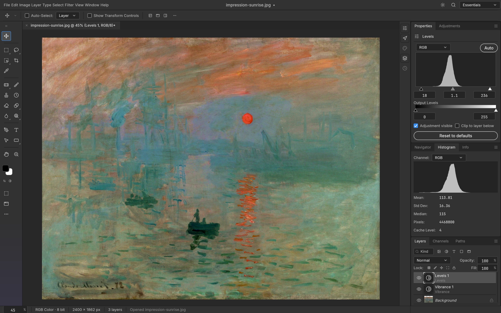
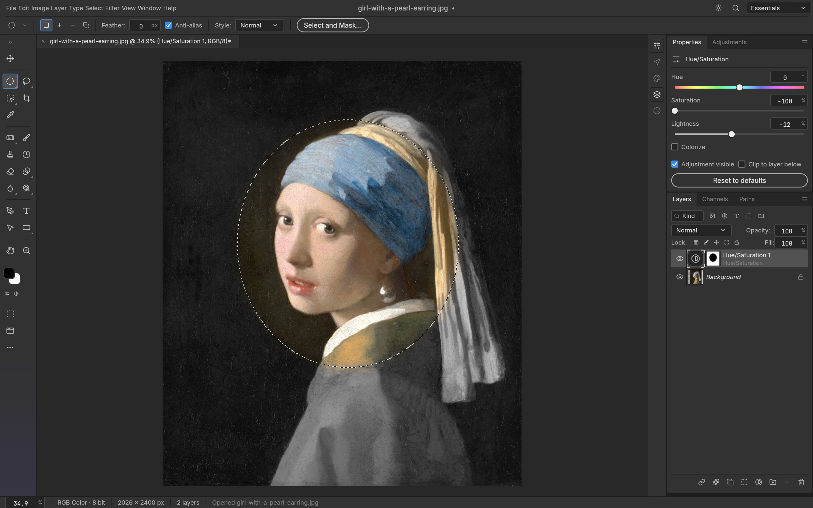
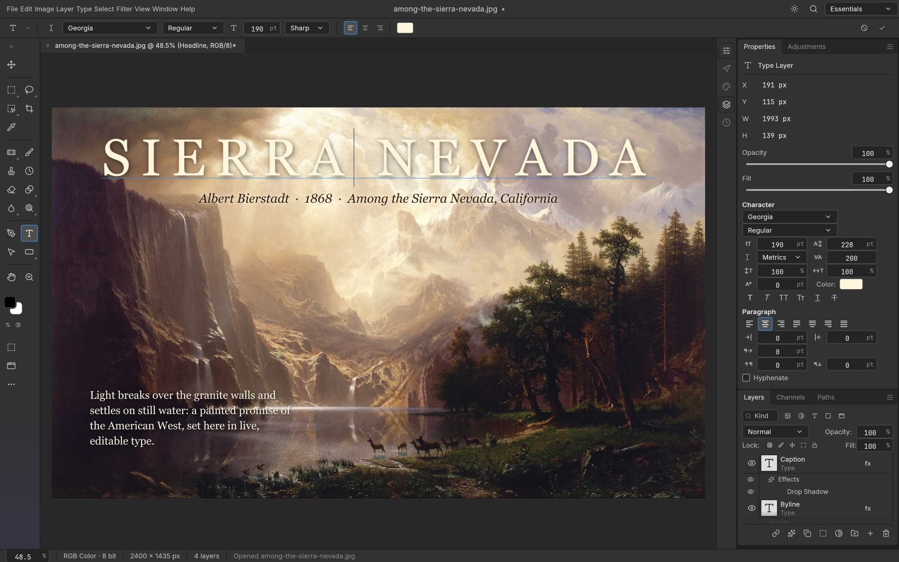
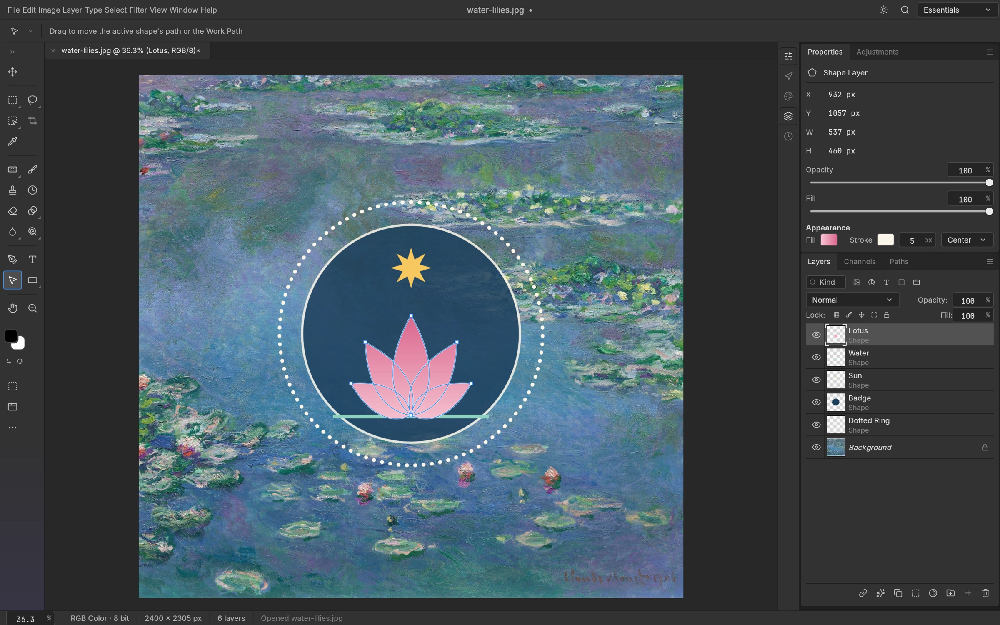
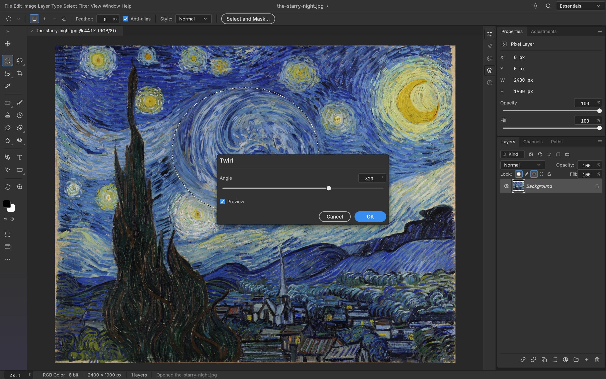
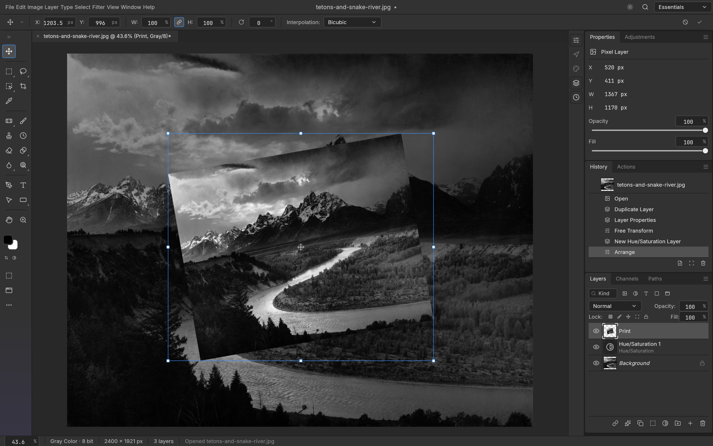
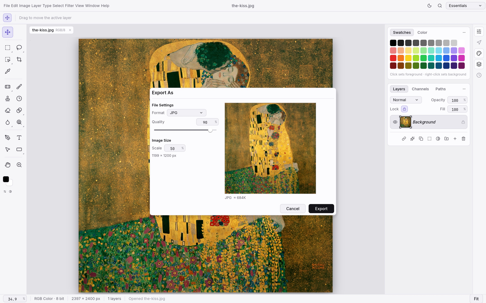
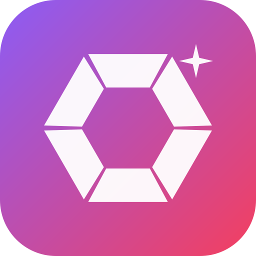

<p align="center">
  <a href="https://salim-studio.github.io/photosweet/">
    <picture>
      <source media="(prefers-color-scheme: dark)" srcset="docs/brand/photosweet-logo-white.svg">
      
    </picture>
  </a>
</p>

<h1 align="center">PhotoSweet</h1>

<p align="center">
  <b>A native, open-source image editor with layers, masks, type and real PSD files, written entirely in Rust.</b><br>
  Layers, masks, adjustment layers, layer styles, type, vectors, brushes and real PSD files,<br>
  in a native app with a GPU compositor. Open source, offline, and yours.
</p>

<p align="center">
  
  
  
  
</p>

<p align="center">
  <a href="https://salim-studio.github.io/photosweet/"><b>Open PhotoSweet in your browser</b></a> ·
  <a href="https://github.com/salim-studio/photosweet">GitHub</a> ·
  <a href="https://github.com/salim-studio/photosweet/issues">Issues</a>
</p>

<br>

<p align="center">
  
  <br>
  <sub>A caption card with a drop shadow, live type, and Vibrance and Curves adjustment layers, with the Curves editor open.<br>
  <i>The Great Wave off Kanagawa</i>, Katsushika Hokusai, c. 1831</sub>
</p>

<p align="center">
  <a href="#features">Features</a> ·
  <a href="#everything-in-the-box">Everything in the box</a> ·
  <a href="#psd-without-compromise">PSD</a> ·
  <a href="#built-for-agents">Agents</a> ·
  <a href="#under-the-hood">Under the hood</a> ·
  <a href="#get-started">Get started</a> ·
  <a href="#downloads">Downloads</a>
</p>

<br>

<table>
  <tr>
    <td width="25%" valign="top">
      <h3>🎛️ Familiar by design</h3>
      The menus, shortcuts, panels and tools are where your hands expect them, from ⌘J to ⇧⌘D. If you know Photoshop, you already know PhotoSweet.
    </td>
    <td width="25%" valign="top">
      <h3>⚡ Native and fast</h3>
      A GPU compositor on wgpu (Metal, Vulkan, DX12, WebGPU), copy-on-write tiles and multithreaded filters. No Electron, no web view, no waiting.
    </td>
    <td width="25%" valign="top">
      <h3>🗂️ Real PSD files</h3>
      Open, edit and save layered Photoshop documents. Re-saving keeps the render of 307 of the 309 psd-tools test files.
    </td>
    <td width="25%" valign="top">
      <h3>🤖 Agent-ready</h3>
      Every action is a command, so you can drive the same engine from the UI, the CLI, a JSON control channel or an MCP server.
    </td>
  </tr>
</table>

<br>

## Features

Every screenshot here is the real app at work on public-domain art, rendered offscreen through its control channel.

<table>
  <tr>
    <td width="50%" valign="top">
      
      <br>
      <sub>Levels and Vibrance adjustment layers, with the live Histogram panel.<br><i>Impression, Sunrise</i>, Claude Monet, 1872</sub>
      <h3>Edit without regret</h3>
      Adjustment layers keep every edit live. Stack Levels, Curves, Vibrance, Hue/Saturation and a dozen more, mask them to an area, reorder them, or turn them off, and your original pixels never change.
      <br><br>
      <b>16 adjustment layers</b> that also apply directly to pixels, including Curves with per-channel editing, Levels with a live histogram, Black &amp; White, Channel Mixer, Gradient Map, Photo Filter, Selective Color and Color Lookup (.cube, .3dl, .look). Plus Shadows/Highlights, Replace Color, Match Color, HDR Toning, Desaturate and Equalize.
    </td>
    <td width="50%" valign="top">
      
      <br>
      <sub>Outer Glow and Stroke on a live type layer, in the Layer Style dialog.<br><i>Earthrise</i>, William Anders / NASA, 1968</sub>
      <h3>Styles that sell the shot</h3>
      Drop Shadow, Inner Shadow, Outer and Inner Glow, Bevel &amp; Emboss, Satin, Stroke, and Color, Gradient and Pattern Overlay, live on any layer, including type. Patterns come from a library (built-ins, Edit › Define Pattern, <code>.pat</code> import/export) and PSD <code>Patt</code> blocks.
      <br><br>
      Copy and paste styles between layers, hide all effects at once, and open styles straight from your PSDs, rendered to match Photoshop.
    </td>
  </tr>
  <tr>
    <td width="50%" valign="top">
      
      <br>
      <sub>An elliptical selection becomes the mask of a Hue/Saturation layer, so only the face keeps its color.<br><i>Girl with a Pearl Earring</i>, Johannes Vermeer, c. 1665</sub>
      <h3>Selections that understand your image</h3>
      Marquees, lassos and the Magic Wand for precision; Quick Selection, Object Selection and Select Subject when you want the computer to do the tracing; Select and Mask to refine hair-fine edges.
      <br><br>
      Feather, expand, contract, smooth, grow, reselect. Turn any selection into a layer mask, a vector path or a shape. Smart selection runs on your machine, with no cloud and no account.
    </td>
    <td width="50%" valign="top">
      
      <br>
      <sub>A headline edited in place, with a byline and a paragraph of body text.<br><i>Among the Sierra Nevada, California</i>, Albert Bierstadt, 1868</sub>
      <h3>Type that sets beautifully</h3>
      Point and paragraph text, edited right on the canvas, with full Character and Paragraph controls: font, weight, size, leading, tracking, alignment and colour. The <a href="docs/color-picker.md">full Type Color Picker</a> also supports screen sampling with a pixel loupe.
      <br><br>
      Type layers stay editable, take layer styles, and round-trip through PSD.
    </td>
  </tr>
  <tr>
    <td width="50%" valign="top">
      
      <br>
      <sub>A badge made of shape layers: a gradient-filled lotus, a star and a dotted ring.<br><i>Water Lilies</i>, Claude Monet, 1906</sub>
      <h3>Pixel-perfect vectors</h3>
      Rectangle, Ellipse, Triangle, Polygon, Line and the Pen, Freeform Pen and Curvature Pen tools, with resolution-independent shape layers, gradient fills, and dashed, aligned strokes.
      <br><br>
      Combine shapes (unite, subtract, intersect, exclude), keep paths in the Paths panel, use them as vector masks, or stroke and fill them. 116 of 116 shape layers in our PSD corpus match Photoshop's pixels.
    </td>
    <td width="50%" valign="top">
      
      <br>
      <sub>Twirl previews live on the canvas, only inside the selection.<br><i>The Starry Night</i>, Vincent van Gogh, 1889</sub>
      <h3>See it before you commit</h3>
      Every filter dialog previews live on the canvas, through your selection. Blurs (Gaussian, Box, Motion, Radial, Surface, Smart, Lens, Shape, and the Blur Gallery: Tilt-Shift, Iris, Field, Spin, Path), sharpening, Reduce Noise, distortions (Twirl, Wave, Ripple, Displace, Shear, Zig Zag…), Pixelate, Stylize (Oil Paint, Wind, Extrude…), Render (Clouds, Fibers, Lens Flare, Lighting Effects) and more.
      <br><br>
      Run filters on a smart object and they stay editable: change, hide, reorder or mask them at any time.
      <br><br>
      Large-radius blurs use running-sum box passes across all cores: a radius-180 Gaussian on 3.6 MP takes under a second.
    </td>
  </tr>
  <tr>
    <td width="50%" valign="top">
      
      <br>
      <sub>Free Transform on a rotated print, with every step listed in History.<br><i>The Tetons and the Snake River</i>, Ansel Adams, 1942</sub>
      <h3>Shape it any way you like</h3>
      Free Transform with scale, rotate, skew, distort and perspective; exact 90° and 180° rotations and flips; Transform Again. Layers, type, shapes, masks and selections all transform together.
      <br><br>
      Full history, Toggle Last State and the History Brush mean every step can be undone, even one brush stroke at a time.
    </td>
    <td width="50%" valign="top">
      
      <br>
      <sub>Export As in the light theme, with a preview and a file-size estimate.<br><i>The Kiss</i>, Gustav Klimt, 1907–1908</sub>
      <h3>Ship it anywhere</h3>
      Export As with format, quality, transparency and scale, plus a preview and an instant file-size estimate. Quick Export to PNG in one click.
      <br><br>
      Choose a dark Pro theme, the airy Studio themes, or a Classic look.
    </td>
  </tr>
</table>

<br>

## Everything in the box

<table>
  <tr>
    <td width="33%" valign="top">
      <h4>🧰 67 tools</h4>
      Move · Artboard · Rectangular and Elliptical Marquee · Single Row Marquee · Single Column Marquee · Lasso · Polygonal Lasso · Magnetic Lasso · Object Selection · Quick Selection · Magic Wand · Crop · Perspective Crop · Slice · Slice Select · Frame · Eyedropper · Color Sampler · Ruler · Note · Count · Remove · Spot Healing Brush · Healing Brush · Patch · Content-Aware Move · Red Eye · Brush · Pencil · Mixer Brush · Color Replacement · Clone Stamp · Pattern Stamp · History Brush · Eraser · Background Eraser · Magic Eraser · Gradient · Paint Bucket · Blur · Sharpen · Smudge · Dodge · Burn · Sponge · Pen · Freeform Pen · Curvature Pen · Add Anchor Point · Delete Anchor Point · Convert Point · Horizontal and Vertical Type · Horizontal and Vertical Type Mask · Path Selection · Direct Selection · Rectangle · Ellipse · Triangle · Polygon · Line · Custom Shape · Hand · Rotate View · Zoom
    </td>
    <td width="33%" valign="top">
      <h4>🖌️ A real brush engine</h4>
      Shape Dynamics, Scattering, Texture, Dual Brush, Color Dynamics, Transfer, Brush Pose, Wet Edges, Build-up and Smoothing (including Pulled String), driven by pen pressure, tilt, rotation and direction. Brush presets, Define Brush from Selection, and deterministic, replayable strokes.
    </td>
    <td width="33%" valign="top">
      <h4>🗃️ Layers, done properly</h4>
      Groups, clipping masks, pixel and vector masks, fill layers (solid, gradient and pattern), adjustment layers, live smart objects with smart filters and lossless transforms and warps, multi-layer selection with align, distribute and link, alpha channels and Quick Mask, 27 Photoshop blend modes plus six Paint.NET variants, opacity and fill, locks, colour labels, a layer kind filter, merge, flatten, rasterize, Layer via Copy/Cut, Paste Into.
    </td>
  </tr>
  <tr>
    <td width="33%" valign="top">
      <h4>🎨 Any colour, any depth</h4>
      RGB, Grayscale, CMYK and Lab documents at 8, 16 and 32 bits per channel. Bit depth and colour model are runtime data, so every tool works at every depth.
      <br><br>
      Real ICC colour management in pure Rust: embedded profiles, Assign and Convert to Profile with all four rendering intents and black point compensation, soft proofing (⌘Y) and Gamut Warning (⇧⌘Y) on the GPU.
    </td>
    <td width="33%" valign="top">
      <h4>🗂️ Formats</h4>
      PSD and PSB, layered TIFF (Photoshop's layer data in the TIFF, read and written in either byte order), <a href="docs/pdn.md">Paint.NET PDN3 (read, with editable layers and all 14 blend modes)</a>, <a href="docs/ora.md">OpenRaster (read and write, with layers, groups and blend modes, for Krita, MyPaint and GIMP)</a>, <a href="docs/kra.md">Krita .kra (read, with paint layers, groups, blend modes and transparency masks)</a>, SVG (opens as shape layers, places as a vector Smart Object), plus flat PNG, JPEG, TIFF, WebP (lossy and lossless), GIF, BMP, TGA, ICO, QOI, PNM, OpenEXR, Radiance HDR and FITS (astronomy images: 8/16-bit and 32-bit float, gray or RGB, header kept), and the native <code>.psweet</code> format. Flat formats retain the depths they support: PNG keeps 8/16-bit samples, TIFF keeps 8/16-bit and 32-bit float samples, and OpenEXR keeps half/float samples; JPEG, WebP and the other 8-bit formats reduce higher-depth samples with an export warning. See the <a href="crates/codecs/README.md#capability-matrix-default-build">codec capability matrix</a> for each format. HEIC photos from iPhone and Mac are read-only (included in official builds; optional <code>--features heif</code> for source builds). AVIF is write-only with the optional <code>avif</code> build feature; AVIF decoding and JPEG XL are unavailable. Affinity documents (<code>.af</code>, <code>.afdesign</code>, <code>.afphoto</code>, <code>.afpub</code>) open natively, read only, with artboards, layers, vectors, text, images and masks; effects, adjustments and other unsupported parts are listed in a warning, and Affinity export is unavailable.
    </td>
    <td width="33%" valign="top">
      <h4>🪄 The everyday essentials</h4>
      Auto Tone, Contrast and Color · Equalize · Image and Canvas Size · Crop and Trim · Reveal All · Edit › Fill and Stroke · Copy Merged · Paste in Place · guides, rulers, grid and snapping · Actions record and replay · a command palette (⌘F).
    </td>
  </tr>
</table>

<br>

## PSD without compromise

PhotoSweet's PSD support is a standalone crate written from Adobe's public specification and tested against a corpus of real-world files.

- **Faithful round trips:** opening and re-saving a document renders the same for 307 of the 309 files in the psd-tools test set and 169 of 170 in our mixed ag-psd/psd-tools set (`crates/io/tests/corpus.rs`; fetch the psd-tools set with `cargo xtask corpus --psd-tools`), and anything we don't model yet (raw blocks, descriptors, extras) is carried over instead of being dropped. A re-saved file is not byte-identical to its source: PhotoSweet rewrites image resources, layer records and the composite. Only the standalone `photosweet-psd` crate, parsing and writing a file without the document model, reproduces every parseable corpus file byte for byte (`crates/psd/tests/corpus.rs`).
- **Pixels that match:** a composite oracle compares our render with Photoshop's own merged image, covering gradient interpolation (Classic, Perceptual and Linear), layer effects, shape strokes, clipping and fill opacity.
- **Large documents:** PSB, 16 and 32-bit files, and CMYK and Lab documents open natively.

## Built for agents

Every menu item, tool and dialog runs a command from one registry of 500+ commands. The UI, the CLI, the JSON control channel and the MCP server all call the same commands, so anything you can click, a script or an AI agent can do too.

```sh
# Headless: open, edit, save
photosweet-cli run wave.psd \
  --cmd filter.sharpen.smartSharpen     --params '{"amount":80}' \
  --cmd layer.newAdjustmentLayer.curves --params '{"points":[[0,0],[64,48],[192,212],[255,255]]}' \
  --out wave-final.png

# Apply one action list to a folder of images
photosweet-cli batch --actions grade.json --in ./raw --out ./graded

# Every subcommand explains itself
photosweet-cli batch --help

# Let an agent drive it over MCP (headless, or bridged to the running app)
photosweet-cli mcp
```

The desktop app also offers an authenticated, loopback-only control channel (`photosweet --control`) for inspecting UI state, driving tools with pointer events, and taking offscreen screenshots. Every image in this README was rendered that way. See [`docs/control-protocol.md`](docs/control-protocol.md).

## Under the hood

- **Engine first:** a pure-data document model and a command engine, with a thin egui UI on top. Layering is enforced at build time across 24 crates.
- **Two compositors:** a CPU compositor serves as the reference oracle, and a wgpu compositor puts the canvas on the GPU. They are tested against each other.
- **Copy-on-write tiles:** 256² sparse tiles make undo cheap and huge canvases light, and effect maps are cached per layer state.
- **Runs in the browser:** the whole engine and UI compile to WebAssembly.
- **Clean-room:** implemented from public specs and observed behaviour only. No proprietary code, shaders or assets.
- **Tested:** more than 1,700 tests, including PSD round trips, synthetic generators, compositor oracles and multi-depth checks.

## Get started

```sh
git clone https://github.com/salim-studio/photosweet
cd photosweet
cargo run --release -p photosweet -- image.psd   # the desktop app
cargo test --workspace                           # the test suite
```

Japanese fonts for the UI and Type tool come from [craft-fonts](https://github.com/storytold/craft-fonts), an optional build input (desktop release builds always include it). Without it PhotoSweet uses your system's CJK fonts:

```sh
git clone https://github.com/storytold/craft-fonts ../craft-fonts
CRAFT_FONTS_DIR="$PWD/../craft-fonts" cargo run --release -p photosweet
```

New contributors and AI agents: start with [`AGENTS.md`](AGENTS.md), then [`docs/`](docs/).

### Run it in the browser

The web build is the same engine and UI compiled to WebAssembly. The published build lives at
[**salim-studio.github.io/photosweet**](https://salim-studio.github.io/photosweet/). To build a
self-contained static site yourself (needs `trunk` and the `wasm32-unknown-unknown` target):

```sh
packaging/web/package.sh            # writes dist/release/photosweet-web-<version>.zip
```

Host the unpacked folder on any static server; there is no server-side code. To self-host with
Docker, see [Docker web hosting](packaging/web/README.md#docker).

> [!IMPORTANT]
> **Status:** PhotoSweet is in early alpha, and we want to be straight about where it stands: much of Photoshop's feature surface exists in some form, but **it is not yet a Photoshop replacement for daily professional work**. The biggest gaps are AI/generative features, 15 missing tools, depth in typography and pro workflows, and plug-in compatibility. Every Photoshop menu item is wired to a command ([`docs/parity-checklist.md`](docs/parity-checklist.md)), but that measures wiring, not behaviour. The honest, dimension-by-dimension picture and where we're going next are in the [roadmap](ROADMAP.md) and [parity assessment](docs/target-app-parity.md). Expect rough edges, and please file [issues](https://github.com/salim-studio/photosweet/issues) (include your OS, document size, layer count and a screenshot).

## Downloads

**The quickest way to try PhotoSweet is the [web build](https://salim-studio.github.io/photosweet/)** — it runs in a modern browser with nothing to install.

Native builds for Windows, macOS, Linux and FreeBSD are produced by the release workflow
(`.github/workflows/release.yml`). Tag a release to generate installers and archives; the file
names below are what the packaging scripts emit (`<ver>` is the version number, and
`SHA256SUMS.txt` lists a checksum for every file).

### Windows

| Build | Installer | Portable |
|---|---|---|
| x64 (64-bit Intel/AMD) | `photosweet-<ver>-windows-x64.msi` | `photosweet-<ver>-windows-x64-portable.zip` |
| arm64 (Snapdragon and other ARM PCs) | `photosweet-<ver>-windows-arm64.msi` | `photosweet-<ver>-windows-arm64-portable.zip` |
| x86 (32-bit) | `photosweet-<ver>-windows-x86.msi` | `photosweet-<ver>-windows-x86-portable.zip` |

### macOS

| Build | File | Notes |
|---|---|---|
| App, universal (Apple silicon + Intel) | `photosweet-<ver>-macos-universal.dmg` | Signed and notarized |
| Command-line tool, universal | `photosweet-cli-<ver>-macos-universal.zip` | Signed and notarized |

### Linux

| Format | x86_64 | aarch64 (ARM64) | Notes |
|---|---|---|---|
| AppImage | `photosweet-<ver>-linux-x86_64.AppImage` | `photosweet-<ver>-linux-aarch64.AppImage` | Runs anywhere; updates itself with [AppImageUpdate](https://github.com/AppImageCommunity/AppImageUpdate) (`.zsync` files) |
| Flatpak | `photosweet-<ver>-linux-x86_64.flatpak` | `photosweet-<ver>-linux-aarch64.flatpak` | Sandboxed; `flatpak install --user <file>` |
| Debian/Ubuntu | `photosweet-<ver>-linux-x86_64.deb` | `photosweet-<ver>-linux-aarch64.deb` | |
| Fedora/RHEL/openSUSE | `photosweet-<ver>-linux-x86_64.rpm` | `photosweet-<ver>-linux-aarch64.rpm` | |
| Tarball | `photosweet-<ver>-linux-x86_64.tar.gz` | `photosweet-<ver>-linux-aarch64.tar.gz` | Unpack anywhere |

RISC-V (riscv64): `photosweet-<ver>-linux-riscv64.tar.gz` only, built against Ubuntu 24.04 (needs glibc 2.39+).

On Linux, the AppImage needs no install: the first run registers its launcher icon and menu entry
in `~/.local/share`. Set `PHOTOSWEET_NO_DESKTOP_INTEGRATION=1` to skip that. The Flatpak bundle
needs the freedesktop runtime from [Flathub](https://flathub.org/setup):

```sh
flatpak install --user photosweet-<ver>-linux-x86_64.flatpak   # or -linux-aarch64
flatpak run studio.salim.photosweet
```

### FreeBSD

| Build | File |
|---|---|
| x86_64 | `photosweet-<ver>-freebsd-x86_64.tar.gz` |

### Web (WebAssembly)

| Build | File | Notes |
|---|---|---|
| Static site | `photosweet-web-<ver>.zip` | Runs in a modern browser; host it on any static server |

Maintainers: [`docs/releasing.md`](docs/releasing.md) explains how releases are built, signed and published.

## Documentation

Developer, architecture, automation, format, and security documentation is maintained in the [PhotoSweet documentation book](book/).

## Security

Security architecture, threat modeling, parser hardening, fuzzing, and vulnerability reporting are covered in the [security documentation](book/src/security/) and the repository [security policy](SECURITY.md).

## Test corpora

PhotoSweet is tested against real files: our own Photoshop-authored oracle PSDs in
[photosweet-corpus](https://github.com/salim-studio/photosweet-corpus) plus the psd-tools, ag-psd and PngSuite sets, pinned and
sha256-verified. Fetch them with `cargo xtask corpus --all` and run the tests with
`cargo xtask test-corpus` (details in [docs/development.md](docs/development.md#test-corpora)).

---

## License and credits

PhotoSweet is dual-licensed under [MIT](LICENSE-MIT) or [Apache-2.0](LICENSE-APACHE), at your option.
Copyright (c) 2026 salim-slimani. Required notices are in [NOTICE](NOTICE).

Bundled fonts, icons, images and other assets keep their own open licenses; each one is listed
with its author, source and license in [ATTRIBUTION.md](ATTRIBUTION.md).

Every artwork shown is in the public domain (Wikimedia Commons, NASA, U.S. National Archives); sources are listed in [`docs/images/SOURCES.md`](docs/images/SOURCES.md).

The PhotoSweet name, mark and wordmark live in [`docs/brand/`](docs/brand/) and are covered by the
same license as the source code ([`docs/brand/LICENSE-brand.txt`](docs/brand/LICENSE-brand.txt)).

<sub>Adobe, Photoshop, Illustrator, Premiere Pro, Lightroom, Acrobat, After Effects and InDesign are trademarks or registered trademarks of Adobe Inc. in the United States and/or other countries. PhotoSweet is an independent, open-source project and is not affiliated with, sponsored by or endorsed by Adobe Inc.; these names are used only to describe the workflows it is compatible with.</sub>

<p align="center">
  <a href="https://salim-studio.github.io/photosweet/"></a><br>
  <sub>Made by <a href="https://github.com/salim-slimani">salim-slimani</a>.</sub>
</p>

<p align="center">
  <a href="https://salim-studio.github.io/photosweet/"></a>
</p>
